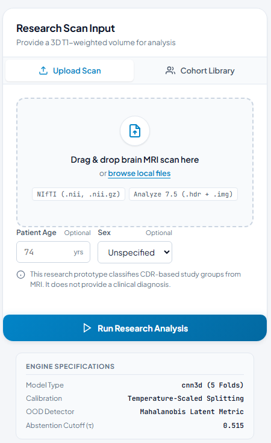

# OASIS-1 MRI research classifier

This repository contains a research pipeline for classifying OASIS-1 participants into CDR-based groups from processed T1 MRI volumes. It includes data preparation, participant-level cross-validation, baseline comparisons, model training, evaluation, and an optional local demo app.

**Research use only. Not a medical device and not for diagnosis or treatment.** CDR-based groups do not establish an Alzheimer's disease or mild cognitive impairment diagnosis. Results from this single-cohort study should not be treated as evidence of clinical performance.

## Interface preview



This crop shows the scan-input panel only. It does not show a participant result or claim model performance.

## Repository contents

- `oasis_ad/`: data handling, preprocessing, models, training, evaluation, and app code.
- `notebooks/`: Colab notebooks for the analysis workflow.
- `configs/default.yaml`: analysis settings and path defaults.
- `tools/make_synthetic_oasis.py`: creates fake data for software checks only.
- `tests/smoke_test.py`: end-to-end smoke test using synthetic data.

The OASIS-1 scans and generated outputs are not included. Obtain the dataset through its authorized source and follow its data-use terms. Keep scans and derived participant data private; do not commit them to this repository.

## Run in Google Colab

1. Upload this repository folder to Google Drive, along with an authorized OASIS-1 data folder containing the disc archives and clinical CSV.
2. Open `notebooks/NB01_Data_Audit_and_Labels.ipynb` in Colab and select a GPU runtime if available.
3. In the setup cells, set `PROJECT`, `DATA_DIR`, and `OUT_DIR` to the Drive locations you use.
4. Run `NB01` through `NB09` in order. Training happens in `NB05`; later notebooks evaluate and export the model bundle. `NB10` runs the demo app, while `NB11` and `NB12` are optional analyses.

The default configuration is written for Colab. Review the paths and settings before running the notebooks. Training duration depends on the selected model, runtime, and available GPU. Keep `OUT_DIR` on Drive if you want intermediate outputs and checkpoints to persist after a Colab disconnect.

## Run a software smoke test

With the dependencies in `requirements.txt` installed, run:

```bash
python tests/smoke_test.py
```

The test uses fabricated OASIS-like data. A passing test checks software execution only; synthetic metrics do not measure real MRI performance.

## Run the app locally

After training and exporting the bundle with `NB09`, download `step9_bundle` and install dependencies:

```bash
python -m pip install -r requirements.txt
python run_app.py --bundle /path/to/step9_bundle
```

On Windows, for example:

```powershell
python run_app.py --bundle "D:\path\to\step9_bundle"
```

Open `http://localhost:8000`. The app is a research demonstration. Its example predictions use study participants and are not independent validation results.

## Before publishing or citing results

- Confirm dataset permissions and cite the dataset source.
- Run the analysis on the authorized real dataset and report the generated evaluation results, including comparison with non-image baselines.
- Verify every literature reference independently.
- Do not describe synthetic test results as model performance or the app as a clinical diagnostic system.
